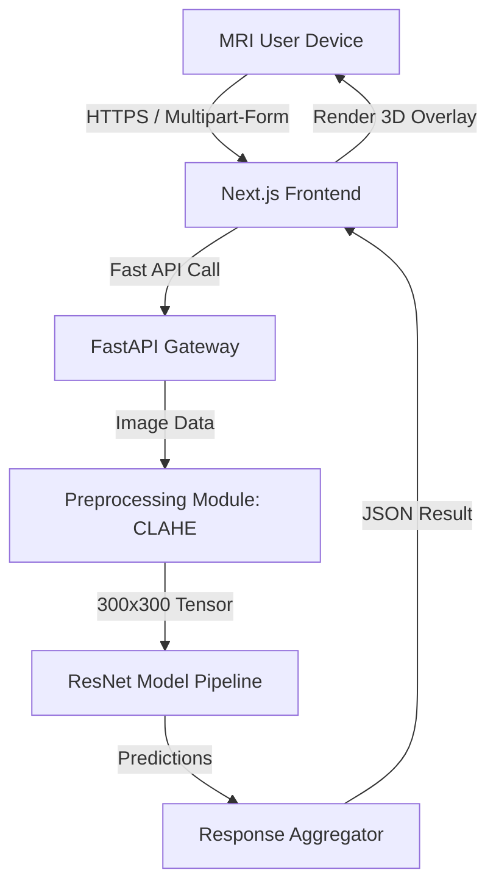

# 🧠 Brain Tumor Detection System: Production Design

## 1. High-Level Architecture
The system follows a **decoupled Client-Server architecture**, separating the resource-heavy ML inference from the interactive user UI.



## 2. Tech Stack (Modern & Scalable)
| Layer | Technology | Rationale |
| :--- | :--- | :--- |
| **Frontend** | Next.js + Tailwind CSS | Fast SSR Loading + Premium UI components (Radix/Framer). |
| **State** | TanStack Query (React Query) | Handles API caching and loading states automatically. |
| **Backend** | FastAPI (Python) | High speed, async, and native Python ML support. |
| **ML Runtime** | ONNX Runtime | Converts PyTorch models to a format that runs faster in production. |
| **Storage** | MinIO / AWS S3 | Dedicated bucket storage for high-resolution medical images. |
| **Queue** | Redis + Celery | Handles concurrent requests without crashing the GPU/CPU. |

## 3. API Flow Definition

### `POST /v1/diagnosis/predict`
**Request:**
- `file`: MRI Image (Multipart/form-data)
- `patient_id`: String (optional)

**Internal Process:**
1.  **Ingestion:** Backend validates image format (DICOM/JPG/PNG).
2.  **Modular Enhancement:** Runs `MedicalEnchanter` (CLAHE) to sharpen edges.
3.  **Inference:** Parallelizes Classification (Glioma/Normal) and Segmentation (Localization).
4.  **Audit:** Logs prediction confidence for clinical reporting.

**Response:**
```json
{
  "diagnostic_id": "8a-241-b3",
  "result": "Meningioma Detected",
  "confidence": 0.982,
  "segmentation_overlay_url": "s3://output/alpha_mask_001.png",
  "recommendation": "Consult Neuro-Radiologist immediately."
}
```

## 4. Scalability & Deployment
- **Dockerization:** Containerize both frontend and backend for platform independence.
- **GPU Acceleration:** Use NVIDIA Triton Inference Server if deploying at a hospital scale.
- **CDN:** Cache landing sections and static assets for global accessibility.

---
*Created by Antigravity AI Engineering - March 2026*
